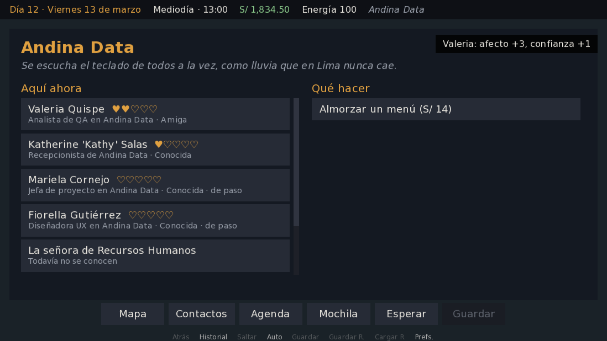
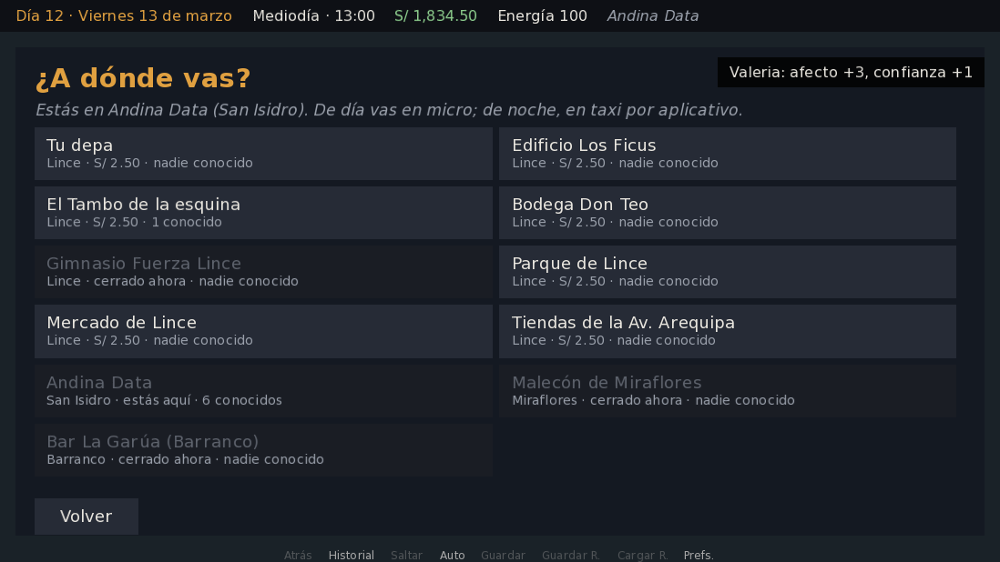
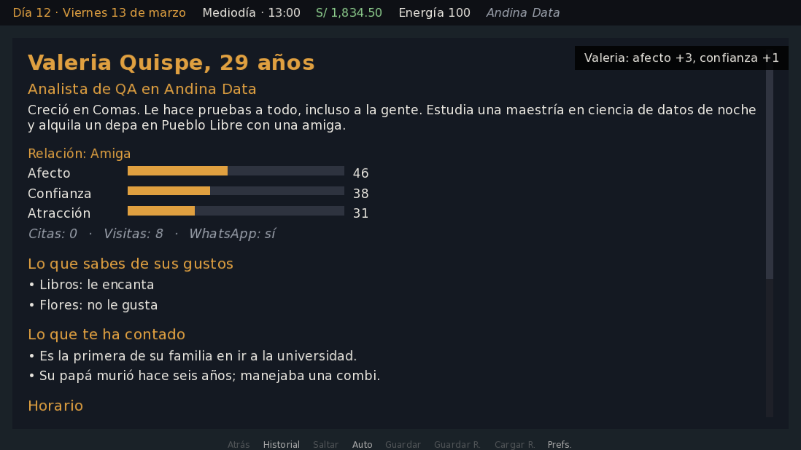

# Lima Gris (versión 0.1.0)

Novela visual de texto para Android y PC, hecha en **Ren'Py**. Toda en español peruano.

Eres un ingeniero de sistemas de 30 años. Te acabas de mudar a un depa en Lince y empiezas a trabajar en **Andina Data**, una consultora de San Isidro. Tienes que llegar a fin de mes, cumplir en la chamba y, si te animas, conocer a la gente que se cruza en tu vida: compañeras de trabajo, vecinas del edificio, las chicas del Tambo de la esquina, la entrenadora del gimnasio, la bartender de Barranco… y hasta tu ex.

Es un juego **solo de texto**: no usa imágenes de personajes. Cada lugar tiene un fondo de color que cambia con la hora del día.

> **+18.** El juego tiene temas de relaciones adultas. La intimidad siempre es con consentimiento claro y termina en un **fundido a negro**: no hay contenido sexual explícito ni estadísticas sexuales.



---

## Índice

1. [Cómo se juega](#cómo-se-juega)
2. [Sistemas](#sistemas)
3. [Personajes](#personajes)
4. [Intimidad: lugares y consecuencias](#intimidad-lugares-y-consecuencias)
5. [Probar el juego en la PC](#probar-el-juego-en-la-pc)
6. [Generar el APK para Android](#generar-el-apk-para-android)
7. [Subirlo a GitHub](#subirlo-a-github)
8. [Estructura de carpetas](#estructura-de-carpetas)
9. [Módulo externo (mi_modulo)](#módulo-externo-mi_modulo)
10. [Agregar personajes y eventos](#agregar-personajes-y-eventos)
11. [Estado de esta versión](#estado-de-esta-versión)

---

## Cómo se juega

El juego empieza el **lunes 2 de marzo**. Cada día tiene 4 momentos: **Mañana, Mediodía, Tarde y Noche**.

En la pantalla principal ves:

- **Aquí ahora:** la gente que está en el lugar en ese momento. Tócala para hablar.
- **Qué hacer:** las acciones del lugar (trabajar, almorzar, entrenar, comprar, ver series, buscar freelance…). Casi todas hacen pasar el tiempo.
- **Abajo:** Mapa, Contactos, Agenda, Mochila, Esperar o Dormir, y Guardar.

Moverse por el mapa **no gasta tiempo**, pero sí pasaje (micro de día, taxi por aplicativo de noche). Cada personaje tiene su **horario**: si la visitas seguido, aprendes dónde encontrarla.

De lunes a viernes trabajas en Andina Data, de mañana a tarde. Si faltas, baja tu **desempeño**, y con buen desempeño te pagan un bono.



---

## Sistemas

| Sistema | Cómo funciona |
|---|---|
| **Relación** | Tres barras: **afecto**, **confianza** y **atracción** (0 a 100). Estados: Conocida → Amiga → Saliendo → Pareja. |
| **Principales y secundarias** | Algunas empiezan como "de paso". Si las visitas seguido (5 visitas y afecto 18), se vuelven principales y desbloquean más cosas. |
| **Charla** | Conversar, preguntarle por su vida (confidencias), coquetear, regalar, invitar a salir, pedir que salgan en serio, proponer ser pareja. |
| **Número y horario** | Con confianza 15 te da su WhatsApp para invitarla desde Contactos. Tras 3 visitas aprendes su horario. |
| **Economía (en soles)** | Sueldo S/ 2,400 cada quincena (día 15 y fin de mes), bono de S/ 300 con buen desempeño. Alquiler S/ 1,100 el día 1, servicios S/ 160 el día 10, gasto diario S/ 25. Empiezas con S/ 1,450. |
| **Freelance** | Desde la laptop de tu depa ves encargos con pago y plazo. Cumplir sube tu reputación y los pagos; si se vence el plazo, la pierdes. |
| **Tienda y regalos** | Flores, chocolates, vino, pisco, cerveza y libros. Cada personaje tiene gustos propios: un regalo que le encanta sube mucho, uno que no le gusta baja. Lo que descubres queda en su perfil. |
| **Citas** | Café en San Isidro, almuerzo en la cevichería de Lucía, cine, paseo por el malecón, cena en Miraflores, tragos en Barranco. Puedes pagar tú o dividir. Hay testigos: si alguien conocido te ve, empieza el chisme. |
| **Rumores** | Cada círculo (oficina, edificio, Tambo, gimnasio, Barranco, barrio) tiene un nivel de rumor. Con mucho rumor te llama Recursos Humanos o Doña Gladys te da un sermón. Si sales con varias a la vez, se enteran y te lo reclaman. |
| **Energía y forma** | Trabajar cansa; dormir, el café y el jugo recuperan. Entrenar sube tu estado físico. |
| **Eventos** | Seis rutas completas (Valeria, Kathy, Mariela, Yesenia, Dani y Rocío), eventos de las demás y eventos del mundo (after office, apagón, caída del sistema, parrillada, aniversario de la empresa). |
| **Guardado** | Botón Guardar en la pantalla principal, más el menú normal de Ren'Py. |



---

## Personajes

**Con ruta completa:**

| Id | Nombre | Quién es |
|---|---|---|
| `valeria` | Valeria Quispe, 29 | Analista de QA en Andina Data |
| `kathy` | Katherine "Kathy" Salas, 27 | Recepcionista de Andina Data |
| `mariela` | Mariela Cornejo, 34 | Jefa de proyecto, mamá de una niña |
| `yesenia` | Yesenia Huamán, 25 | Cajera del Tambo, turno mañana |
| `dani` | Daniela "Dani" Torres, 28 | Cajera del Tambo, turno noche |
| `rocio` | Rocío Zevallos, 36 | Tu vecina del 302, enfermera |

**Con evento propio (para ampliar):** `fiorella` (diseñadora UX), `jimena` (jefa de RR. HH.), `brenda` (analista junior), `andrea` (vecina, estudiante de Derecho), `lucia` (vecina, dueña de una cevichería), `mila` (entrenadora del gimnasio), `camila` (socia del gimnasio), `mery` (bodega Don Teo), `sofia` (librera), `carla` (bartender en Barranco), `paola` (tu ex, aparece el día 8).

**Personajes de apoyo:** Piero (tu pata de la oficina), el Sr. Benavides (gerente), Doña Gladys (portera del edificio), Don Teo (bodeguero) y la tía Norma (te llama los domingos).

---

## Intimidad: lugares y consecuencias

Cuando la relación es lo bastante fuerte (estado "Saliendo" o más, con afecto, confianza y atracción altos), de noche aparece la opción **"Proponerle que la noche siga juntos"** (también al final de una cita nocturna).

1. **Consentimiento primero.** Le preguntas. Ella puede decir que no, según su humor y la relación, y el juego lo respeta.
2. **Eliges el lugar.** Las opciones dependen de dónde están, la hora y quién es ella:

| Lugar | Cuándo aparece |
|---|---|
| Tu depa | Siempre (taxi si están lejos) |
| Su depa | Depende de con quién vive: si vive con sus padres o su familia, nunca; con su hermana o su hija, solo ciertos días |
| Hostal (S/ 70) / Hotel (S/ 220) | Siempre, más el taxi |
| La oficina | Si están en Andina Data de noche y ella es de la oficina |
| La azotea del edificio | Si son vecinas, de noche |
| Un callejón | En Barranco o el malecón, de noche |
| Su carro | Si ella tiene carro y no están en el edificio |
| El almacén del Tambo | Con Dani, en el Tambo |
| El vestidor del gimnasio | Con alguien del gimnasio, de noche |
| La trastienda de la bodega | Con Mery, de noche |

Cada personaje tiene **preferencias**: a algunas les encanta la idea de un lugar arriesgado y otras se niegan. Ella puede decir "ahí no", y eliges otro lugar o lo dejan para otro día.

3. **Fundido a negro**, o la escena de tu módulo si la conectaste.
4. **Consecuencias según el lugar**, por ejemplo:
   - **Tu depa:** Doña Gladys los ve entrar y mañana lo sabe todo el edificio, o los vecinos golpean la pared.
   - **Su depa:** la roomie te hace un interrogatorio, la hermana llega temprano, la prima te dice "cuñado".
   - **Hostal:** un vecino del barrio los ve salir.
   - **Oficina:** el vigilante y las cámaras. Chisme fuerte en la oficina y **citación de Recursos Humanos**.
   - **Callejón:** te cae el Serenazgo, o te cruzas con alguien conocido que sale del bar.
   - **Almacén:** llega el supervisor y ella se gana un memorándum.
   - **Vestidor / trastienda:** te pescan y el chisme corre por el gimnasio o el barrio.
   - **Hotel:** caro, pero tranquilo y sin chismes.

---

## Probar el juego en la PC

1. Descarga el **Ren'Py SDK 8** (versión 8.1 o más nueva) desde https://www.renpy.org/latest.html y descomprímelo.
2. Abre el lanzador (`renpy.exe` en Windows, `renpy.sh` en Linux, `renpy.app` en Mac).
3. En **Preferencias → Directorio de proyectos**, elige la carpeta que **contiene** a `LimaGris` (no la carpeta `LimaGris` misma).
4. Selecciona **LimaGris** en la lista de proyectos y presiona **Ejecutar proyecto**.
5. Para revisar errores: **Comprobar script (Lint)**. Esta versión pasa el lint sin errores.

---

## Generar el APK para Android

No pude generar el APK yo mismo: en el entorno donde se hizo el juego están bloqueadas las descargas de renpy.org y de Google, que se necesitan para el SDK de Android. Hazlo en tu PC con estos pasos (la primera vez toma unos 20 o 30 minutos, casi todo es descarga).

**Necesitas:**

- Ren'Py SDK 8.1 o más nuevo.
- **Java JDK.** Ren'Py 8.2 o más nuevo usa el JDK 21. Ren'Py 8.1 usa el JDK 17. Una opción es Eclipse Temurin (https://adoptium.net).
- Unos 5 GB libres y buena conexión.

**Pasos en el lanzador de Ren'Py:**

1. Selecciona el proyecto **LimaGris** y entra a **Android**.
2. **Instalar SDK** (*Install SDK*). Descarga el SDK de Android y acepta las licencias que te pida.
3. **Generar claves** (*Generate Keys*). Crea la llave con la que se firma tu APK.
   **Guarda una copia de esa llave** (`android.keystore` y `bundle.keystore`, o la carpeta que te indique el lanzador). Sin ella no podrás actualizar la app más adelante. **No la subas a GitHub** (el `.gitignore` ya la excluye).
4. **Configurar** (*Configure*). Responde:
   - Nombre de la app: `Lima Gris`
   - Nombre corto: `Lima Gris`
   - Paquete: `pe.limagris.juego`
   - Versión: `0.1.0`
   - Orientación: **horizontal (landscape)**
   - Lo demás, por defecto.
5. Elige **Universal APK** (no "Play Bundle"), para instalarlo directo en el celular.
6. **Construir paquete** (*Build Package*).
7. El APK queda en la carpeta `bin/` del SDK (o en la que indique el lanzador al terminar).
8. Pásalo al celular e instálalo. Android te pedirá permitir "instalar apps de origen desconocido".

Con el celular conectado por USB y la **depuración USB** activada, también puedes usar **Construir e instalar** (*Build & Install*).

**Íconos:** los archivos `android-icon_foreground.png`, `android-icon_background.png` y `android-presplash.jpg` de la raíz ya son el ícono y la pantalla de carga. Si quieres los tuyos, reemplázalos con el mismo nombre (los íconos miden 432×432).

---

## Subirlo a GitHub

```bash
cd LimaGris
git init
git add .
git commit -m "Lima Gris 0.1.0"
git branch -M main
git remote add origin https://github.com/TU_USUARIO/TU_REPO.git
git push -u origin main
```

El `.gitignore` ya excluye lo que Ren'Py genera solo (`*.rpyc`, `cache/`, `saves/`, `log.txt`, `traceback.txt`), los APK y las llaves de firma.

---

## Estructura de carpetas

```
LimaGris/
├── README.md
├── android-icon_*.png, android-presplash.jpg   ← ícono y carga en Android
├── capturas/                                   ← imágenes de este README
└── game/
    ├── options.rpy, gui.rpy, screens.rpy       ← configuración y menús de Ren'Py
    ├── gui/                                    ← imágenes de la interfaz
    ├── nucleo/                                 ← motor del juego
    │   ├── 00_config.rpy        lugares, precios, sueldo, tienda, citas, umbrales
    │   ├── 10_estado.rpy        variables que se guardan en la partida
    │   ├── 20_funciones.rpy     calendario, dinero, relaciones, horarios, rumores
    │   ├── 30_pantallas.rpy     HUD, pantalla principal, mapa, perfil, agenda, tienda
    │   ├── 40_bucle.rpy         bucle principal, acciones, dormir y pagos
    │   ├── 50_charla.rpy        conversaciones, regalos, coqueteo, declaraciones
    │   ├── 60_citas.rpy         invitaciones y citas
    │   ├── 70_intimidad.rpy     consentimiento, lugares y consecuencias
    │   ├── 80_eventos_globales.rpy
    │   └── 90_inicio.rpy        aviso +18 e introducción
    ├── personajes/
    │   ├── 00_personajes.rpy    Character de cada uno y orden
    │   ├── datos_*.rpy          fichas: horario, gustos, diálogos, confidencias
    │   ├── ruta_*.rpy           rutas completas
    │   └── eventos_secundarias.rpy
    └── modulos/mi_modulo/       ← TU módulo (ver abajo)
```

Para cambiar el sueldo, los precios o los umbrales, edita `game/nucleo/00_config.rpy`.

---

## Módulo externo (mi_modulo)

`game/modulos/mi_modulo/` es tuyo. El juego lo lee, pero no lo modifica, y puedes ampliarlo sin tocar el núcleo. Tiene tres partes:

### 1. `variables.rpy`: tus estadísticas

```renpy
default modulo_stats = {}          # {"valeria": {"Mi stat": 3}, ...}

$ sumar_stat("valeria", "Mi stat", 1)   # suma (crea la stat si no existe)
$ x = leer_stat("valeria", "Mi stat")   # lee (0 si no existe)
```

Todo lo que pongas en `modulo_stats` aparece **automáticamente** en el perfil del personaje, en una sección llamada **"Módulo"**.

### 2. `escenas/*.rpy`: tus escenas

Cada escena es un `label` que termina en `return`. Puedes crear todos los archivos `.rpy` que quieras en esa carpeta.

```renpy
label mi_modulo_valeria_hostal:
    scene black with dissolve
    va "..."
    $ sumar_stat("valeria", "Noches en el hostal", 1)
    return
```

**Variables que tu escena puede leer:**

- `escena_personaje`: id del personaje (`"valeria"`).
- `escena_lugar`: id del lugar (`"hostal"`).
- `escena_punto`: en qué momento se llamó.

**Funciones útiles:**

- `nom(pj)`: su nombre corto.
- `di(pj, "texto")`: hace hablar a cualquier personaje por su id.
- `R(pj)`: su ficha de relación, con `afecto`, `confianza`, `atraccion`, `estado`, `citas`, `noches`…

No cambies `dia`, `slot` ni `ubicacion` dentro de tu escena: el juego se encarga.

**Variables de los personajes para diálogo:** `p` (protagonista), `va` Valeria, `ka` Kathy, `ma` Mariela, `fi` Fiorella, `ji` Jimena, `br` Brenda, `ye` Yesenia, `da` Dani, `me` Mery, `ro` Rocío, `an` Andrea, `lu` Lucía, `mi` Mila, `ca` Camila, `so` Sofía, `cr` Carla, `pa` Paola, `pi` Piero, `be` Benavides, `gladys`, `te` Don Teo, `norma`.

### 3. `conexiones.rpy`: qué escena se usa y cuándo

```renpy
define modulo_conexiones = [
    {
        "personaje": "valeria",            # id, o "*" para cualquiera
        "escena": "mi_modulo_valeria_hostal",
        "requisitos": {"punto": "intimidad", "lugar": "hostal", "afecto": 60},
    },
]
```

El juego revisa la lista **de arriba hacia abajo** y usa la **primera** conexión que cumpla. Si el `label` no existe (`renpy.has_label`), la salta. Si ninguna cumple, hace su fundido a negro normal.

**Puntos de enganche (`"punto"`):**

| Punto | Cuándo se llama | `escena_lugar` vale |
|---|---|---|
| `"intimidad"` (por defecto) | En lugar del fundido a negro | `depa_tuyo`, `depa_ella`, `hostal`, `hotel`, `oficina`, `azotea`, `callejon`, `carro`, `almacen`, `vestidor`, `trastienda` |
| `"despertar"` | A la mañana siguiente, después de las consecuencias | el mismo lugar |
| `"beso"` | Primer beso al final de una cita | el lugar de la cita |
| `"cita"` | Durante cualquier cita | `cafe`, `cevicheria`, `cine`, `malecon`, `cena`, `bar` |
| `"evento"` | Al terminar un evento de ruta | `val_05`, `val_06`, `kat_06`, `mar_06`, `yes_06`, `dan_06`, `roc_06` |

**Requisitos (todos opcionales):**

| Clave | Ejemplo | Significado |
|---|---|---|
| `lugar` | `"hostal"` o `["hostal", "hotel"]` | Uno o varios lugares |
| `afecto`, `confianza`, `atraccion` | `60` | Mínimo (0 a 100) |
| `estado` | `"Saliendo"` o `2` | Mínimo: Conocida 0, Amiga 1, Saliendo 2, Pareja 3 |
| `veces_min` / `veces_max` | `2` | Noches juntos que llevan. En `intimidad` y `despertar` ya cuenta la de esa noche (1 = la primera) |
| `citas_min` | `3` | Citas mínimas |
| `dia_min` | `20` | Día del juego mínimo |
| `slot` | `3` | 0 mañana, 1 mediodía, 2 tarde, 3 noche |
| `flag` | `"roomie_valeria"` | Un flag activo |
| `evento` | `"roc_05"` | Un evento ya visto |
| `stats` | `{"Mi stat": 3}` | Mínimos de tus `modulo_stats` |

Viene un ejemplo activo y neutro: un desayuno al despertar (`mi_modulo_desayuno`), que suma la stat "Desayunos juntos". Sirve para comprobar que el módulo funciona. Bórralo cuando quieras.

---

## Agregar personajes y eventos

### Un personaje nuevo

1. En `game/personajes/00_personajes.rpy`, crea su `Character`: `define xx = Character("Nombre", color="#rrggbb")`.
2. Copia una ficha de `datos_*.rpy` (por ejemplo la de Fiorella) y cambia el id y los datos: `horario` (dónde está cada día y momento), `gustos`, `saludo`, `charla`, `confidencias`, `coqueteo`, `regalo`, `lugares` (preferencia por lugar íntimo, de 0 a 3), `rechazos`, etc.
3. Agrega su id a `ORDEN_PJ` en el mismo `00_personajes.rpy`.

Las partidas guardadas antiguas lo reconocen solas al cargar.

### Un evento nuevo

```renpy
init python:
    registrar_evento(id="fio_02", pj="fiorella", label="ev_fio_02",
                     lugar="barranco", slots=[3], afecto=40, eventos=["fio_01"])

label ev_fio_02:
    fi "..."
    $ cambiar("fiorella", afecto=5, confianza=3)
    return
```

Claves útiles de `registrar_evento`:

- `lugar`: un lugar o una lista.
- `slots`: momentos del día.
- `dias_semana`: 0 = lunes.
- `dia_min`.
- `afecto`, `confianza`, `atraccion`, `citas`: mínimos.
- `estado`, `estado_max`.
- `principal=True`: solo si ya es principal.
- `eventos`: eventos previos.
- `flags`, `sin_flags`.
- `cond`: una función que devuelve True o False.
- `repetible`.
- `prioridad`.

Todo evento termina en `return`.

---

## Estado de esta versión

**Probado:**

- Lint de Ren'Py sin errores.
- Un bot que juega solo 45 días sin fallos.
- Un recorrido automático por todos los eventos, todas las citas, la intimidad en todos los lugares, todas las charlas, todas las pantallas, todas las acciones y 70 días de calendario, con 0 errores.
- Pantallas revisadas en resolución de PC y de celular.

**Para próximas versiones:**

- Rutas completas para Fiorella, Jimena, Brenda, Andrea, Lucía, Mila, Camila, Mery, Sofía, Carla y Paola (por ahora tienen un evento cada una).
- Música y sonido.

**Límites de contenido (a propósito):**

- Sin contenido sexual explícito.
- Sin mecánicas sin consentimiento.
- La historia y los personajes son originales.
